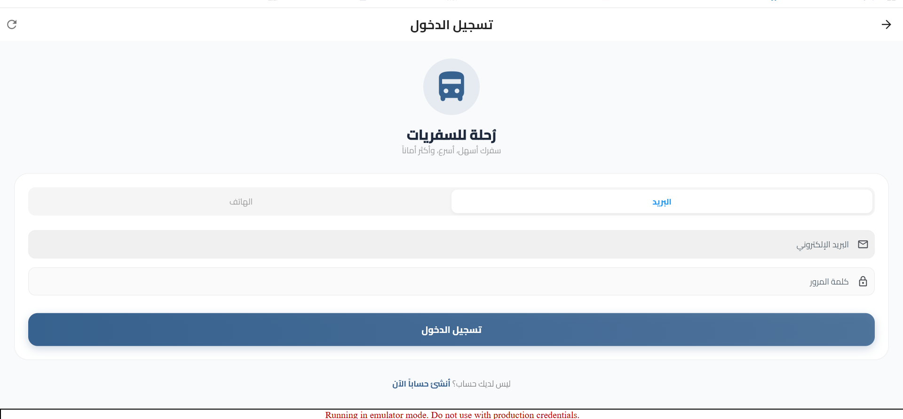
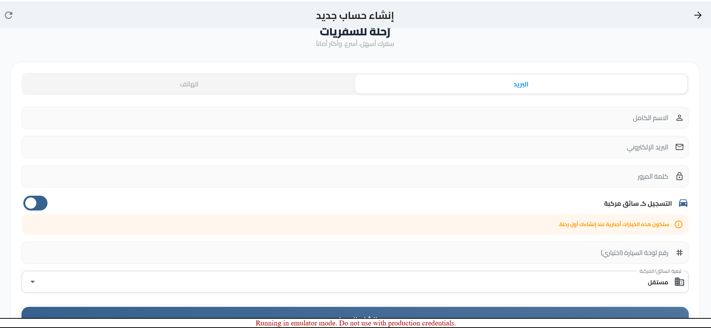
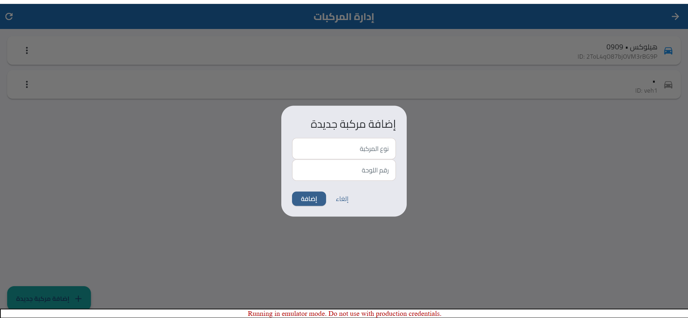
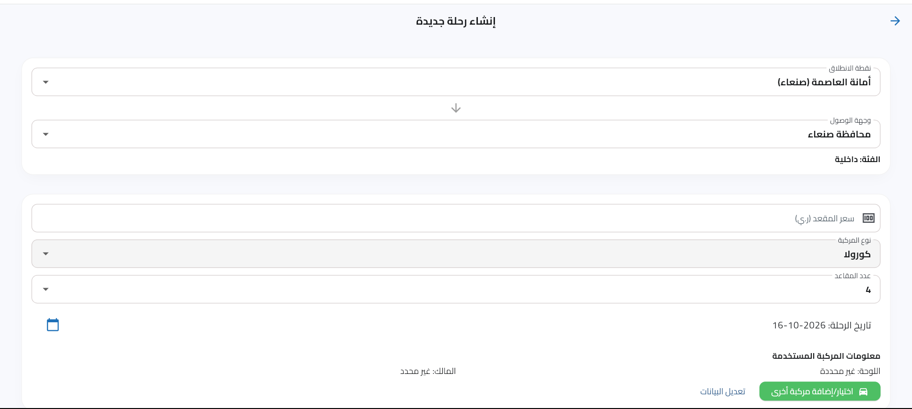
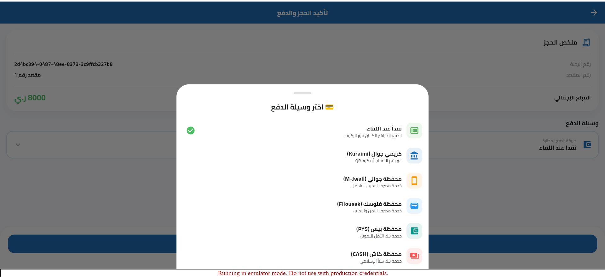
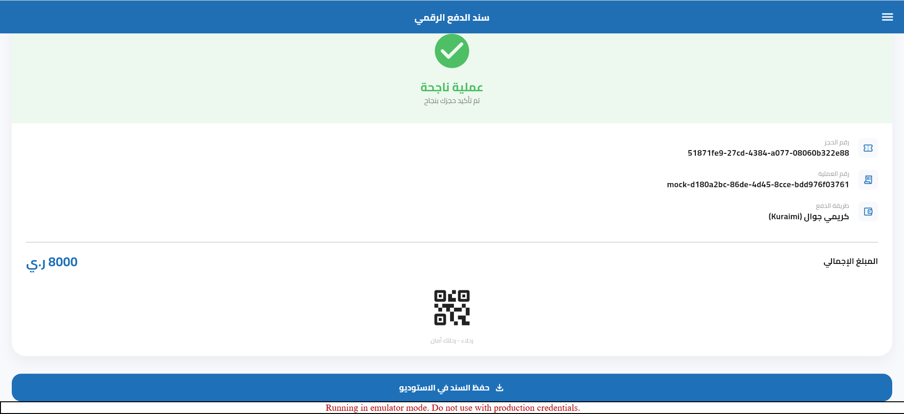
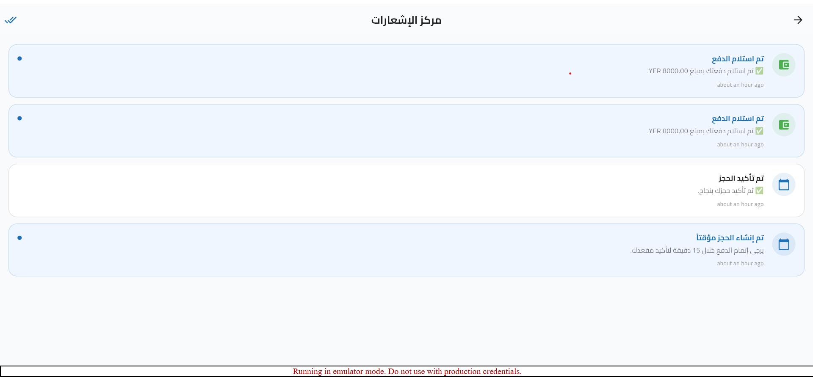
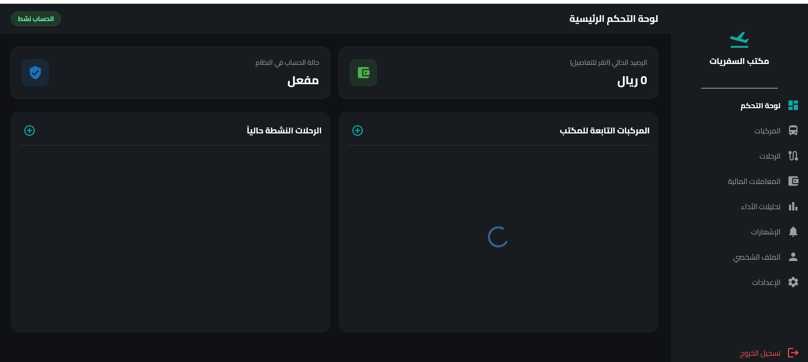
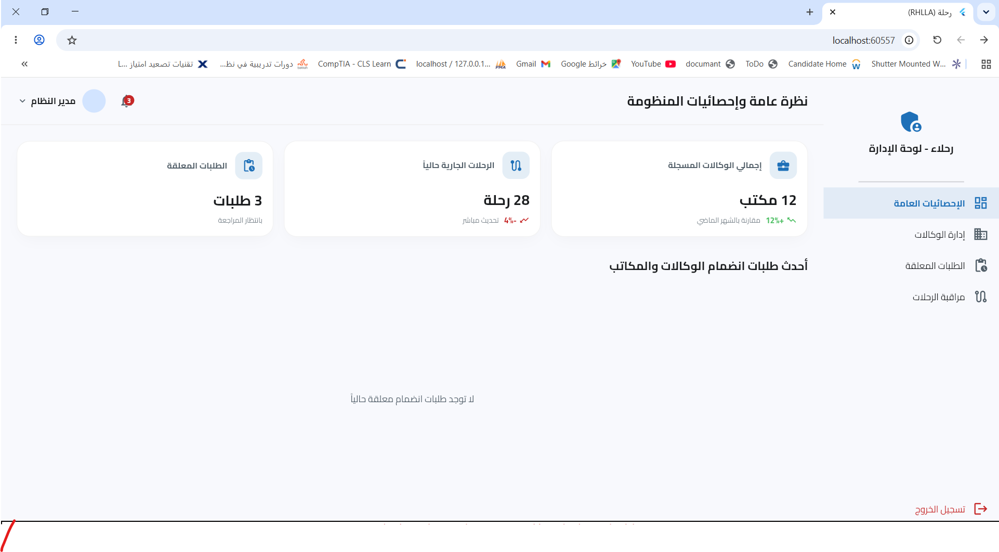

🚍 منصة رحلة | RHLAA Platform
منصة ذكية لإدارة النقل البري والرحلات والحجوزات
Smart Transportation Management Platform
FlutterFirebaseFirestoreProviderPlatformStatus

🇸🇦 العربية
📖 نبذة عن المشروع
رحلاء (RHLAA) هي منصة رقمية متكاملة لإدارة النقل البري والرحلات والحجوزات تم تطويرها باستخدام Flutter و Firebase بهدف رقمنة وتحسين العمليات التشغيلية المتعلقة بالنقل وإدارة الرحلات والمركبات والحجوزات والمدفوعات.

تربط المنصة بين:

الركاب
السائقين
الوكالات ومكاتب النقل
الجهات الإدارية
الجهات التنظيمية
وتوفر منظومة موحدة لإدارة:

الرحلات
الحجوزات
المركبات
المدفوعات
المحافظ الرقمية
الرسوم الحكومية
العمولات
الإشعارات
التقارير
الوثائق التشغيلية
🎯 الرؤية
بناء منصة تقنية متقدمة تسهم في تطوير قطاع النقل من خلال توفير حلول رقمية موثوقة وآمنة وقابلة للتوسع.

📨 الرسالة
توفير منصة رقمية حديثة تساعد على إدارة الرحلات والحجوزات والمدفوعات والعمليات التشغيلية بكفاءة وتحسين تجربة جميع المستخدمين.

🚀 المميزات الرئيسية
👤 الراكب
البحث عن الرحلات
فلترة الرحلات
حجز المقاعد
متابعة الحجوزات
الدفع
استقبال الإشعارات
تقييم السائقين
متابعة الرحلات القادمة
🚘 السائق
إدارة الملف الشخصي
رفع الوثائق
إدارة المركبات
إنشاء الرحلات
تعديل الرحلات
إدارة الحجوزات
إدارة المقاعد
توليد كشف الركاب PDF
🏢 الوكالات ومكاتب النقل
إدارة بيانات الوكالة
إدارة المركبات
إدارة الرحلات
إدارة الحجوزات
إدارة المعاملات
إدارة المحفظة
تحديد موقع المكتب على الخريطة
👨‍💼 الإدارة
إدارة المستخدمين
إدارة الوكالات
مراقبة العمليات
إدارة الرحلات
إدارة البيانات التشغيلية
🏛 الجهات التنظيمية
الاطلاع على البيانات المسموح بها
مراجعة كشوفات الرحلات
التحقق من المعلومات التشغيلية
🌍 دعم اللغات
✅ العربية

✅ الإنجليزية

✅ التبديل بين اللغات أثناء تشغيل التطبيق

✅ دعم RTL

✅ نظام Localization باستخدام ARB Files

🎨 تجربة المستخدم
✅ الوضع الليلي (Dark Mode)

✅ الوضع النهاري (Light Mode)

✅ تغيير الثيم أثناء التشغيل

✅ Material Design 3

✅ Responsive Design

✅ واجهات عربية وإنجليزية

📍 الخرائط والموقع الجغرافي
✅ Google Maps Integration

✅ تحديد موقع المكتب

✅ إدارة مواقع الوكالات

✅ Geolocation Services

✅ حفظ بيانات الموقع

💳 نظام الدفع
✅ Wallet Payments

✅ QR Code Payments

✅ Payment Confirmation

✅ Deep Link Support

✅ Commission Calculation

✅ Government Fee Calculation

✅ Payment Tracking

📄 التقارير والمستندات
✅ Passenger Manifest PDF

✅ Trip Reports

✅ Excel Export

✅ Downloadable Documents

✅ Passenger Lists

🔔 الإشعارات
✅ Push Notifications

✅ Booking Notifications

✅ Payment Notifications

✅ Trip Notifications

✅ Notification Preferences

✅ Read / Unread Management

🛡 الأمان والحوكمة
✅ Firebase Authentication

✅ Firestore Security Rules

✅ Role Based Access Control (RBAC)

✅ Driver Verification

✅ Identity Verification

✅ Agency Validation

✅ Ownership Validation

✅ Protected Financial Data

✅ Default Deny Security Strategy

⚡ الأداء والتحسين
✅ Firebase Emulator Suite

✅ Firestore Composite Indexes

✅ Query Optimization

✅ Local Testing Environment

✅ Service Layer Architecture

✅ Provider State Management

✅ Firebase Cloud Functions

🧩 الوحدات الرئيسية
Authentication
تسجيل الدخول
إنشاء الحسابات
إدارة الجلسات
إدارة الأدوار
Trip Management
إنشاء الرحلات
تعديل الرحلات
إدارة المقاعد
إدارة حالة الرحلات
Booking Management
الحجز
تأكيد الحجز
إلغاء الحجز
الحجز العائلي
Vehicle Management
إدارة المركبات
ربط المركبات بالسائق
التحقق من المركبات
Agency Management
إدارة الوكالة
المحفظة
المعاملات
الموقع الجغرافي
Payment System
الدفع
الرسوم الحكومية
العمولات
المحافظ
Reporting
PDF
Excel
كشوفات الركاب
Notification System
الإشعارات الفورية
الإشعارات المحلية
إعدادات الإشعارات
🛠 التقنيات المستخدمة
Frontend
Flutter
Dart
Provider
Material Design 3
Backend
Firebase Authentication
Cloud Firestore
Firebase Storage
Firebase Cloud Messaging (FCM)
Firebase Cloud Functions
Maps & Location
Google Maps Flutter
Geolocator
Notifications
Firebase Messaging
Flutter Local Notifications
Reporting
PDF
Syncfusion Excel
Localization
flutter_localizations
intl
intl_utils
Payments
QR Flutter
Barcode Widget
URL Launcher
🏗 هيكل المشروع
lib
│
├── l10n
│
├── models
│
├── providers
│
├── screens
│   ├── admin
│   ├── agency
│   ├── driver
│   └── passenger
│
├── services
│
├── state
│
├── theme
│
├── utils
│
├── widgets
│   ├── admin
│   ├── agency
│   ├── driver
│   ├── passenger
│   └── shared
│
├── firebase_options.dart
└── main.dart
## 📸 لقطات الشاشة | Screenshots

### 🔐 تسجيل الدخول

  

### 🚗 إنشاء حساب سائق

  

### 🚙 إدارة المركبات

  

### 🛣️ إنشاء رحلة

  

### 💳 تأكيد الحجز والدفع

  

### 🧾 سند الدفع والـ QR

  

### 🔔 مركز الإشعارات

  

### 🏢 لوحة تحكم المكاتب

  

### 🏛️ لوحة الجهة الحكومية

  

### ⚙️ لوحة الإدارة

  

📚 التوثيق
docs/
├── PROJECT_SUMMARY.md
├── ARCHITECTURE.md
├── DATABASE_SCHEMA.md
├── FIRESTORE_RULES.md
├── SECURITY_AND_GOVERNANCE.md
└── LOCAL_TESTING.md
🇬🇧 English
Overview
RHLAA is a transportation management platform built using Flutter and Firebase.

The platform provides a unified ecosystem for managing transportation operations, including trips, bookings, vehicles, payments, notifications, agencies, commissions, government fees, and operational reports.

It connects:

Passengers
Drivers
Transportation Agencies
Administrators
Regulatory Authorities
Key Features
✅ Trip Management

✅ Vehicle Management

✅ Passenger Bookings

✅ QR Code Payments

✅ Government Fee Calculation

✅ Commission Engine

✅ Google Maps Integration

✅ Agency Location Management

✅ Mode

✅ Push Notifications

✅ PDF Manifest Generation

✅ Excel Export

✅ Firebase Cloud Functions

✅ Firestore Composite Indexes

✅ Firebase Security Rules

✅ Firebase Emulator Suite

Technology Stack
Frontend
Flutter
Dart
Provider
Material Design 3
Backend
Firebase Authentication
Cloud Firestore
Firebase Storage
Firebase Cloud Messaging
Firebase Cloud Functions
Maps & Location
Google Maps Flutter
Geolocator
Reporting
PDF
Excel
Notifications
Firebase Messaging
Flutter Local Notifications
Documentation
docs/
├── PROJECT_SUMMARY.md
├── ARCHITECTURE.md
├── DATABASE_SCHEMA.md
├── FIRESTORE_RULES.md
├── SECURITY_AND_GOVERNANCE.md
└── LOCAL_TESTING.md
Developer
Mohammed Abdulrahman Saif Aqlan Al-Qadsi

Computer & IT Engineer

Flutter Developer • Firebase Developer • DevOps Engineer • Network Engineer

GitHub: https://github.com/mohammedaqlan27

Email: abdulrahmanaqlan10@gmail.com

Future Vision
RHLAA is currently developed as an independent transportation platform with a long-term vision of evolving into a large-scale transportation ecosystem that supports digital transformation, smart mobility, and transportation management services.